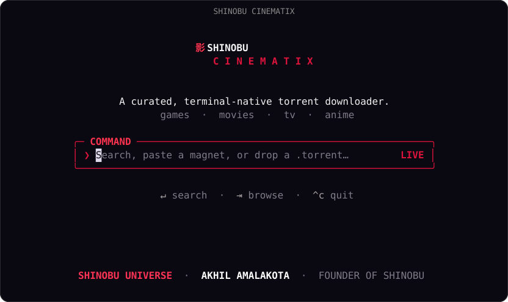
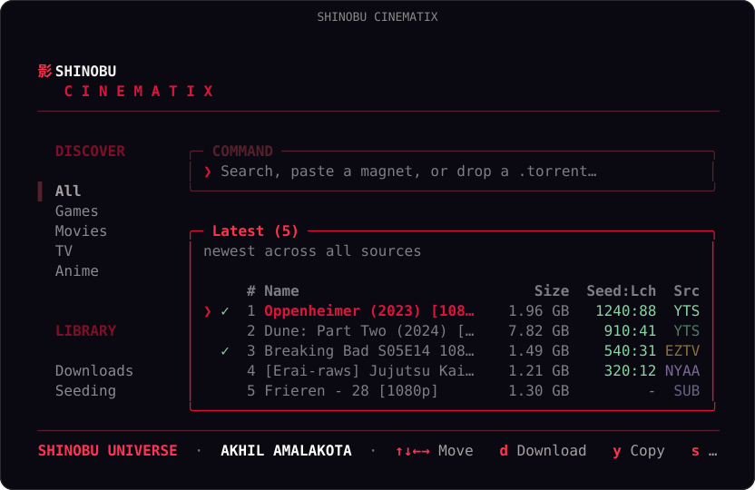
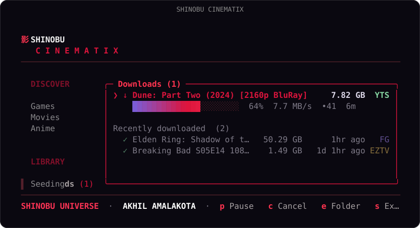

# THE SHINOBU UNIVERSE

<p align="center">
  
</p>

<p align="center">
  <strong>A SHINOBU UNIVERSE ORIGINAL</strong>
</p>

<h1 align="center">SHINOBU CINEMATIX</h1>

<p align="center">
  A cinematic, terminal-native torrent discovery and downloader.
  <br>
  Discover. Download. Seed. All from your terminal.
</p>

<p align="center">
  <strong>CONCEIVED · CREATED · ENGINEERED BY</strong>
  <br>
  <strong><h2>AKHIL AMALAKOTA</h2></strong>
  <strong>FOUNDER OF SHINOBU</strong>
</p>

---

## 影 THE SHINOBU UNIVERSE

An independent universe of products, ideas, and technology.

SHINOBU CINEMATIX is an original product from the SHINOBU universe — built to bring a cinematic torrent discovery and downloading experience directly to your terminal.

**One universe. Multiple creations. One identity.**

## About CINEMATIX

SHINOBU CINEMATIX brings torrent discovery and downloading directly into your terminal.

Search across multiple sources, browse results, download files, manage active transfers, and seed completed downloads — all through an interactive terminal interface.

No browser full of popups. No unnecessary setup. Just your terminal.

## Features

- **Multi-source discovery:** Search multiple torrent sources simultaneously.
- **Interactive terminal UI:** Browse results, manage downloads, and navigate with keyboard shortcuts.
- **Batch downloads:** Select multiple results and download them together.
- **Magnet support:** Paste magnet links or infohashes directly.
- **Torrent file support:** Open `.torrent` files.
- **Download management:** Track progress, speed, peers, and estimated time remaining.
- **Movie-folder organization:** Keep each new download organized in its own folder.
- **Automatic seeding:** Share completed downloads with other peers.
- **Seeding controls:** Pause, resume, and manage uploads.
- **Playlist generation:** Generate M3U playlists for suitable multi-file downloads.
- **Headless operation:** Run supported operations without the interactive interface.
- **Network controls:** Bind torrent traffic to a selected network interface.
- **Persistent history:** Keep track of completed downloads between sessions.

## Installation

### Requirements

- Node.js 22 or newer.
- Windows, macOS, or Linux.
- An internet connection.

### Run instantly with npx

```sh
npx shinobu-cinematix
```

### Install globally

```sh
npm install -g shinobu-cinematix
```

Then launch:

```sh
shinobu-cinematix
```

## Getting started

Once launched, SHINOBU CINEMATIX opens its interactive search interface.

Enter a search query and press Enter.

You can also:

- Paste a magnet link.
- Paste a bare infohash.
- Open a `.torrent` file.
- Browse the available library.

Use the arrow keys to navigate results.

Press `d` to download the selected result. Use Space to mark multiple results before downloading them together.

Press `?` to view the available keyboard shortcuts.

## Finding something

Search results stream in as sources respond. Results include information such as file size and available seeders.

Select a result and press `d` to download it.

Use `Shift+D` to choose a destination folder for a result or selected batch without changing your default download location.

<p align="center">
  
</p>

## Your downloads

The Downloads pane displays active transfers with:

- Download progress.
- Transfer speed.
- Estimated remaining time.
- Peer information.

Completed downloads appear in your history.

New downloads are organized into individual movie folders, keeping related files together.

Press `o` to change the default download directory.

Completed downloads can automatically seed so other peers can retrieve them.

<p align="center">
  
</p>

## Playlist generation

When a download contains multiple media files, SHINOBU CINEMATIX can generate a `playlist.m3u` file for folders containing multiple supported files.

To disable playlist generation:

```sh
shinobu-cinematix --no-playlist
```

## What it searches

SHINOBU CINEMATIX uses a selection of torrent sources. Source availability may change over time.

## Headless operation

SHINOBU CINEMATIX can also run without its interactive terminal interface.

```sh
shinobu-cinematix search "<query>" --category movies
shinobu-cinematix seed <path>
shinobu-cinematix watch <dir>
shinobu-cinematix serve
shinobu-cinematix files
shinobu-cinematix attach
```

Use:

```sh
shinobu-cinematix --help
```

for the complete command and option reference.

## Sharing something of your own

You can create a torrent from your own files and share it with others:

```sh
shinobu-cinematix seed ./my-folder
```

The application creates torrent metadata, prints the magnet link, and begins seeding.

## Network interface binding

You can bind torrent traffic to a specific network interface:

```sh
shinobu-cinematix serve --interface wg0 --peer-port 51413
```

The existing `TORLINK_INTERFACE`, `TORLINK_PEER_PORT`, and `TORLINK_DHT_PORT` environment variable names remain supported for compatibility.

## Development

Clone the repository:

```sh
git clone https://github.com/akhilamalakota/shinobu-cinematix.git
cd shinobu-cinematix
```

Install dependencies:

```sh
npm install
```

Run the development version:

```sh
npm run dev
```

Build the application:

```sh
npm run build
```

Run the bundled application:

```sh
npm start
```

Run TypeScript checks:

```sh
npm run typecheck
```

Run tests:

```sh
npm test -- --maxWorkers=1
```

## Contributing

Contributions, bug reports, and suggestions are welcome.

Before opening a pull request, review the project's contribution guidelines if available.

## Privacy

Your downloaded files are stored locally on your device.

SHINOBU CINEMATIX communicates with torrent sources and the peer-to-peer network to perform its discovery, downloading, and seeding functionality.

Completed downloads can continue seeding by default. You remain in control: use the Seeding tab to pause or stop individual transfers.

Always use torrent networks responsibly and respect applicable copyright laws.

---

<p align="center">
  <strong>THE SHINOBU UNIVERSE</strong>
  <br>
  <strong>SHINOBU CINEMATIX</strong>
  <br><br>
  <strong>A PRODUCT CREATED BY</strong>
  <br>
  <h2>AKHIL AMALAKOTA</h2>
  <br>
  <a href="https://github.com/akhilamalakota/shinobu-cinematix">GitHub</a>
  ·
  <a href="https://shinobu.in">Website</a>
  ·
  <a href="https://github.com/akhilamalakota/shinobu-cinematix/issues">Issues</a>
  <br><br>
  MIT License
  <br><br>
  <em>Like a shadow. Vanish.</em>
</p>